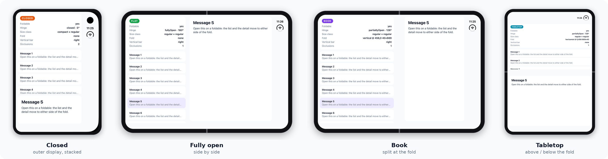

# react-native-foldable-kit

**Make your React Native app iPhone Duo and Android foldable ready.** Fold posture, hinge, fold and camera regions, size classes, the iPhone Duo vertical bar edge and a fold-aware split view, behind one tiny API.

- One API for **iPhone Duo** (iOS 27.1 `UIHingeInteraction`, `reservedRegions`, `verticalBarEdge`) and **Android foldables** (Jetpack WindowManager `FoldingFeature`, hinge angle sensor, display cutouts): Galaxy Z Fold / Flip, Pixel Fold, OnePlus Open, Surface Duo and others.
- **Zero runtime dependencies.** No Expo, Nitro, Reanimated or worklets needed. ~4 KB of JS gzipped.
- **No provider.** Hooks read a shared store and re-render only when *their* value changes.
- **Cheap by default.** The continuous hinge angle stays off until a component asks for it.
- **Safe everywhere.** On regular phones, tablets, web, older iOS or older Xcode you get inert defaults. It never throws.
- New Architecture TurboModule (RN 0.79+). Works in bare React Native and in Expo dev builds.

## Demo



The [demo app](./example/App.tsx) on the **iPhone Duo simulator (iOS 27.1)**. The panel shows what the hooks report live; `FoldableSplit` moves the panes around the fold. Full-size shots: [docs/SCREENSHOTS.md](./docs/SCREENSHOTS.md) · [layout diagram](./docs/layouts.png).

Run the demo yourself:

```sh
git clone https://github.com/aravi365/react-native-foldable-kit && cd react-native-foldable-kit
scripts/create-example.sh                 # bare RN app in example/FoldableKitDemo
(cd example/FoldableKitDemo && npx react-native run-ios)      # iPhone Duo simulator (Xcode 27.1)
(cd example/FoldableKitDemo && npx react-native run-android)  # Pixel Fold / foldable emulator
scripts/capture-screenshots.sh ios        # or android: saves each posture to docs/screenshots
```

The demo shows a live panel (posture, hinge angle, size class, fold frame, vertical bar edge, occlusions) above a list/detail `FoldableSplit`.

## Install

```sh
npm install react-native-foldable-kit
cd ios && pod install
```

Expo: `npx expo install react-native-foldable-kit` and use a development build (Expo Go is not supported).

**iOS:** build with **Xcode 27.1+** (iOS 27.1 SDK). Older SDKs still compile, but the iPhone Duo APIs report inert values and iOS runs your app in compatibility mode (not edge-to-edge).
**Android:** nothing to configure. Uses `androidx.window` 1.5.

## Quick start

```tsx
import { FoldableSplit, usePosture, useIsWide } from 'react-native-foldable-kit';

export function Mail() {
  return (
    <FoldableSplit
      primary={<Inbox />}
      secondary={<Message />}
      compact="primary"   // narrow screens: just the list
      ratio={0.4}         // wide screens without a fold: 40/60
    />
  );
}
```

`FoldableSplit` puts the panes on either side of the fold when the device is half open (book → left/right, tabletop → top/bottom), side by side on wide windows (iPhone Duo inner display, an unfolded Android phone, tablets), and stacked or single on narrow ones.

## Hooks

| Hook | Returns | Use it for |
|---|---|---|
| `useSizeClass()` | `{ horizontal, vertical }`: `'compact' \| 'regular'` | **Your main layout input.** Native traits on iOS, window size elsewhere. |
| `useIsWide()` | `boolean` | Shorthand for regular width (room for two panes). |
| `usePosture()` | `'book' \| 'tabletop' \| 'flat' \| 'closed' \| 'unknown'` | Posture-specific UI (e.g. video above, controls below in tabletop). |
| `useFoldRegion()` | `FoldRegion \| null` | Keeping buttons and text off the crease. Window coordinates, pt/dp. |
| `useOcclusions()` | `ReservedRegion[]` | Keeping controls clear of cameras, cutouts and the Dynamic Island. |
| `useVerticalBarEdge()` | `'left' \| 'right' \| null` | Putting your own rail on the same side as the iPhone Duo system bar. |
| `useHinge({ angle? })` | `{ status, angle }` | Effects driven by the hinge. Pass `{ angle: true }` for live degrees (0 closed, 180 flat). |
| `useIsFoldable()` | `boolean` | Showing foldable-only features. |
| `useFoldable()` | full `FoldableState` | Everything at once (re-renders on any change). |

Outside React: `getFoldableState()` and `addFoldableListener(fn)`.

```tsx
function Player() {
  const posture = usePosture();
  return posture === 'tabletop' ? <VideoTopControlsBottom /> : <Video />;
}

function FloatingButton() {
  const fold = useFoldRegion();
  const left = fold?.orientation === 'vertical' ? fold.frame.x + fold.frame.width + 16 : 16;
  return <Fab style={{ position: 'absolute', left, bottom: 24 }} />;
}

function Turntable() {
  const { angle } = useHinge({ angle: true }); // effects only, never layout
  return <Record rotate={`${angle ?? 180}deg`} />;
}
```

## Getting your app iPhone Duo ready: checklist

1. **Build with Xcode 27.1** so your app goes edge to edge on both displays.
2. **Lay out from the window size or `useSizeClass()`.** Never use `Dimensions.get('screen')` values cached at startup, `Platform.isPad` or hard-coded widths. The outer display is compact width, the inner one is regular/regular.
3. **Respect left/right safe areas.** iPhone Duo puts a vertical system bar on one side. Use `react-native-safe-area-context` with `edges={['left','right', …]}`, and place custom rails using `useVerticalBarEdge()`.
4. **Don't depend on orientation locks.** On the inner display your app can be resized or scaled. `requireFullScreen` and orientation locks are no longer guaranteed.
5. **Keep interactive content off the fold** (`FoldableSplit` or `useFoldRegion()`) and clear of cameras (`useOcclusions()`).
6. **Use the hinge for effects, not layout.** Apple's guidance: lay out from size and regions.
7. **Test** in Xcode 27.1's Device Hub iPhone Duo simulator (open / close / fold / rotate controls) and on an Android Studio *Foldable* or *Pixel Fold* emulator using the posture controls in the extended controls panel.

## Platform behaviour

| | iPhone Duo (iOS 27.1+) | Android foldables | Other devices |
|---|---|---|---|
| Hinge status | `UIHinge.status` | `FoldingFeature.state`, plus angle sensor for `closed` | `unknown` |
| Hinge angle | `UIHinge.angle` | `TYPE_HINGE_ANGLE` sensor (Android 11+) | `null` |
| Fold region | `reservedRegions(.division)` | `FoldingFeature.bounds` (separating) | none |
| Occlusions | `reservedRegions(.occlusion)` | display cutouts | cutouts on Android, none on iOS < 27.1 |
| Vertical bar edge | `traitCollection.verticalBarEdge` | `null` | `null` |
| Size class | native traits | from window size (600dp / 480dp) | native on iOS, window size elsewhere |

Notes:
- Android reports a fold only while your window spans it. On the outer display of a closed device posture is `closed` (from the hinge sensor) or `unknown`.
- Dual-screen devices with a physical gap (Surface Duo) report `flat` *with* a separating fold, and `FoldableSplit` still splits around it.
- Region frames are window coordinates in points/dp, comparable with `measureInWindow`. On Android this assumes the default edge-to-edge root view (RN 0.81+).

## Jest

```js
jest.mock('react-native-foldable-kit', () => require('react-native-foldable-kit/jest'));

import { setMockFoldableState } from 'react-native-foldable-kit/jest';
setMockFoldableState({ posture: 'tabletop', isFoldable: true });
```

## Why another package?

Earlier libraries each cover one slice: iOS-only Duo signals, hinge only (sometimes pulling in Nitro, worklets or Expo), or a provider-scoped regions view. This kit combines the parts you need to ship (posture, fold, occlusions, size class, bar edge, a ready-made split view) for **both** platforms, with no dependencies. See [NOTICE](./NOTICE) for credits.

## License

MIT
