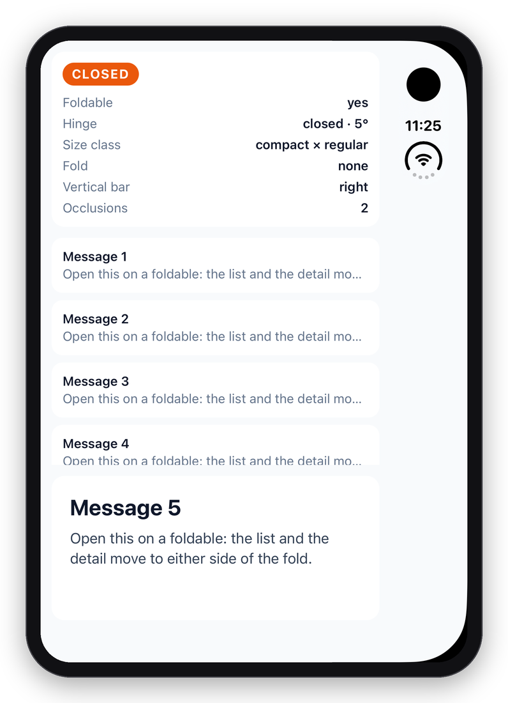
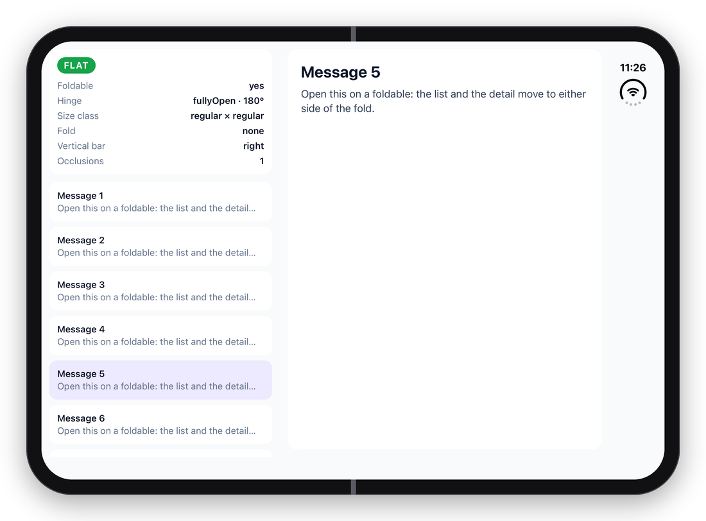
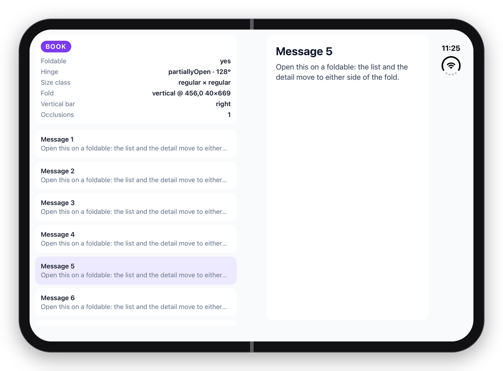
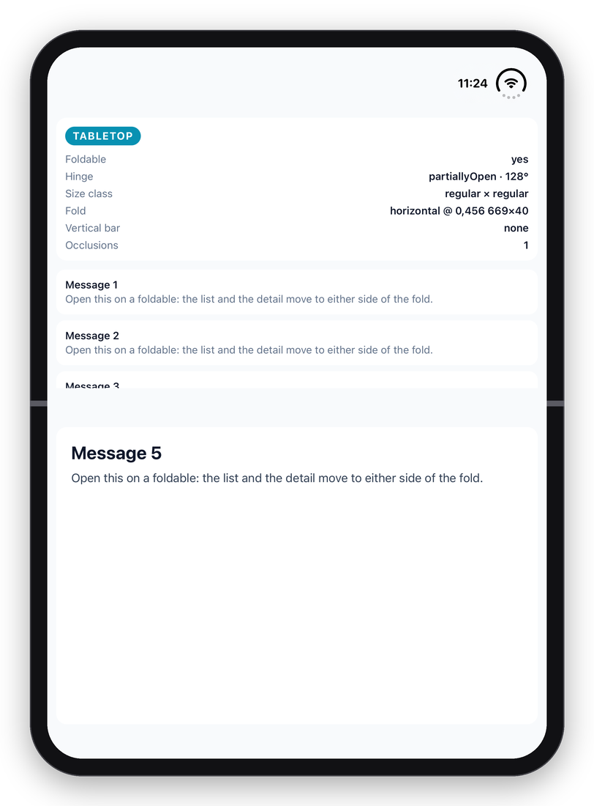

# Screenshots

Real captures of [`example/App.tsx`](../example/App.tsx), framed with `scripts/frame-screenshots.py`.

## iPhone Duo (iOS 27.1 simulator)

| Closed | Fully open |
|---|---|
|  |  |
| `closed · 5°`, compact × regular, vertical bar right | `fullyOpen · 180°`, regular × regular, no separating fold |

| Book | Tabletop |
|---|---|
|  |  |
| `partiallyOpen · 128°`, vertical fold `456,0 40×669` | `partiallyOpen · 128°`, horizontal fold `0,456 669×40` |

## Android foldable (Pixel 9 Pro Fold emulator)

Coming soon.
